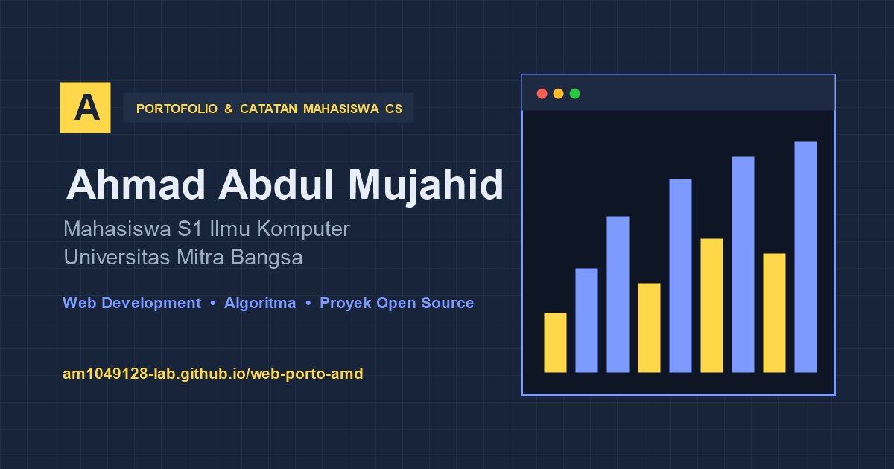

# 🚀 Portofolio Ahmad Abdul Mujahid — Mahasiswa Ilmu Komputer



> Situs web portofolio pribadi bertema **neo-brutalisme teknis modern**. Dibuat secara mandiri menggunakan **HTML5, CSS3, dan JavaScript murni (Vanilla JS)** tanpa dependensi framework luar untuk menghasilkan performa maksimal, aksesibilitas tinggi, dan waktu muat instan.

🔗 **Live Demo:** [https://am1049128-lab.github.io/web-porto-amd/](https://am1049128-lab.github.io/web-porto-amd/)

---

## 🌟 Fitur Utama

- **Interactive CS Sorting Lab**:
  - Simulasi visual 3 algoritma pengurutan: **Bubble Sort**, **Selection Sort**, dan **Insertion Sort**.
  - Metrik *real-time*: jumlah perbandingan (*comparisons*) dan pertukaran (*swaps*).
  - Kontrol kecepatan animasi dan analisis kompleksitas waktu Big-O (*Time & Space Complexity*).
  - Efek paralaks 3D interaktif mengikuti pergerakan kursor mouse.
- **Mode Gelap & Terang (Dark/Light Mode)**:
  - Tersinkronisasi otomatis dengan preferensi sistem dan disimpan di `localStorage`.
- **Studi Kasus Proyek Nyata**:
  - Dokumentasi proyek unggulan **SejukPro** (kalkulator kebutuhan pendinginan BTU & estimasi biaya listrik AC).
  - Badge status pengembangan (*live/active*).
- **Section Sertifikat & Pembelajaran**:
  - Validasi kompetensi mandiri di bidang Web Development, Git & GitHub, dan Algoritma.
- **Navigasi Responsif & Halus**:
  - Menu drawer untuk perangkat *mobile/smartphone*.
  - Scroll indicator progress bar di bagian atas layar.
  - Active navigation spy berbasis `IntersectionObserver`.
- **Interaksi Kontak Cepat**:
  - Fitur **Salin Cepat (Copy-to-Clipboard)** untuk email dan nomor WhatsApp dengan notifikasi toast.
  - Form terhubung langsung ke WhatsApp API dan klien Email.
- **SEO & Social Sharing Preview**:
  - Metadata Open Graph (WhatsApp/LinkedIn) dan Twitter Card lengkap dengan gambar banner (`og-image.png`).

---

## 📁 Struktur Berkas

```text
porto/
├── index.html           # Struktur semantik halaman utama
├── css/
│   └── style.css        # Desain neo-brutalism, responsif, dark mode
├── js/
│   ├── sorting.js       # Engine visualisasi algoritma pengurutan & metrik
│   └── main.js          # Kontrol interaksi, navigasi, toast, dan form kontak
├── og-image.png         # Banner Open Graph 1200x630 untuk media sosial
├── foto.jpg             # Foto profil
├── cv.pdf               # Berkas kurikulum vitae
└── README.md            # Dokumentasi proyek
```

---

## 🛠️ Teknologi yang Digunakan

- **HTML5**: Semantik, aksesibel, dan terstruktur.
- **CSS3**: CSS Variables (Custom Properties), Flexbox, CSS Grid, Media Queries, dan Animasi GPU-accelerated.
- **JavaScript (ES6+)**: Async/Await, IntersectionObserver API, Clipboard API, dan DOM Manipulation.
- **Tipografi**: Bricolage Grotesque & Figtree (Google Fonts).

---

## 💻 Menjalankan Secara Lokal

1. Salin (*clone*) repositori ini:
   ```bash
   git clone https://github.com/am1049128-lab/web-porto-amd.git
   ```
2. Buka folder proyek:
   ```bash
   cd web-porto-amd
   ```
3. Buka berkas `index.html` langsung di peramban favorit Anda (atau gunakan ekstensi *Live Server* di VS Code).

---

## 👤 Pengembang

**Ahmad Abdul Mujahid**  
- Mahasiswa S1 Ilmu Komputer — Universitas Mitra Bangsa
- Email: [am1049128@gmail.com](mailto:am1049128@gmail.com)
- GitHub: [@am1049128-lab](https://github.com/am1049128-lab)
